# Tran Tuan Nghia

**Computer vision · Robotics · Backend engineering** 
Ho Chi Minh City, Vietnam

I'm an AI undergraduate at **University of Technology Sydney (UTS)**, a **Computer Vision & Robotics research assistant at IVS**, and **co-founder of Odylytics**.

[LinkedIn](https://www.linkedin.com/in/tuannghia2457/) · [Odylytics](https://odylytics.com/) · [LeetCode](https://leetcode.com/u/ZCODgO0oKn/)

## What I want to build

- **Perception and navigation software** for robots and UAVs, using computer vision, LiDAR, mapping and geometric reasoning.
- **Reliable backend services** for AI-enabled applications, with clear APIs, data flows and reproducible experiments.
- **Practical tools for people**, from flood-response coordination to software that supports focus.

## Selected projects

### AquaGuard

*Flood alerts & rescue coordination · Team project*

Connects citizens, rescuers and administrators through flood maps, GPS-based SOS requests, live rescue tracking and family safety updates.

**Stack:** `React` · `Node.js` · `Express` · `PostgreSQL` · `Firebase`

[Website](https://aquaguard.vn/) · [Source](https://github.com/tuannghia2457/AquaGuard-WebApp) · [Business model](https://github.com/tuannghia2457/BMC_AquaGuard)

### VirtualDouble / ANT

*Focus companion · Hackathon project*

Task breakdown, supportive check-ins, a floating focus window and a recovery workspace, with optional on-device face landmarks. Camera frames stay on the device.

**Stack:** `Next.js` · `TypeScript` · `MediaPipe` · `Web Audio`

[Demo](https://adc-hackathon-ant.vercel.app/) · [Source](https://github.com/tuannghia2457/Hackathon-ANT)

### UAV Localization

*Research prototype · In progress*

Exploring canopy features and geometric matching to estimate UAV position in forest environments where GNSS is unavailable or unreliable.

**Stack:** `C++` · `Python`

## Tech stack

**Languages**

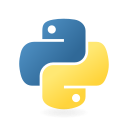 &nbsp; 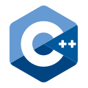 &nbsp; 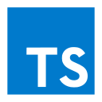 &nbsp;  &nbsp; 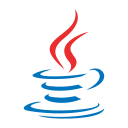 &nbsp; 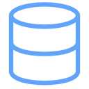

Python · C++ · TypeScript · JavaScript · Java · SQL

**AI, vision & robotics**

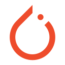 &nbsp;  &nbsp; 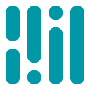 &nbsp; 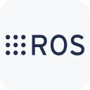 &nbsp;  &nbsp; 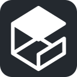

PyTorch · OpenCV · MediaPipe · ROS 2 · Nav2 · Gazebo · RViz

**Web & backend**

 &nbsp; 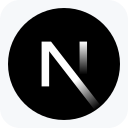 &nbsp; 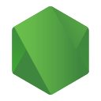 &nbsp;  &nbsp;  &nbsp; 

React · Next.js · Node.js · Express · PostgreSQL · Firebase

**Development**

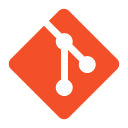 &nbsp; 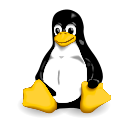 &nbsp; 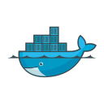 &nbsp; 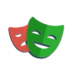

Git · Linux · Docker · Playwright

## Research & recognition

- **CTMIA 2026** — Presented research on pothole surface reconstruction.
- **EPICS Season 8** — 1st Place with AquaGuard (2026).
- **Bach Khoa Innovation** — First Runner-Up with AquaGuard (2026).
- **InnoStars & Leave a Nest** — Finalist with AquaGuard (2026).
- **UTS Dean's List** — Academic achievement (2026).
