<!-- GitHub Profile README | github.com/tuannghia2457 -->

**AI Undergraduate @ UTS** · **Computer Vision & Robotics Research Assistant @ IVS**

**Co-Founder @ Odylytics**

### `> about`

I work on perception and navigation for robots and UAVs, with interests in **computer vision, LiDAR, mapping, and geometric reasoning**. Alongside research, I build software that supports disaster response and everyday focus.

### `> featured_projects`

<table>
<tr>
<td width="50%" valign="top">

#### 🌊 AquaGuard

**Flood alerts & rescue coordination**

A team project connecting citizens, rescuers, and administrators through flood maps, GPS-based SOS requests, live rescue tracking, and family safety updates.

`React` · `Node.js` · `Express` · `PostgreSQL` · `Firebase`

[**Live platform ↗**](https://aquaguard.vn/) · [**Web source ↗**](https://github.com/tuannghia2457/AquaGuard-WebApp) · [**Business model ↗**](https://github.com/tuannghia2457/BMC_AquaGuard)

</td>
<td width="50%" valign="top">

#### 🧠 VirtualDouble / ANT

**A focus companion with browser-side vision**

A hackathon project with optional, on-device face landmarks, supportive check-ins, task breakdown, a floating focus window, and a recovery workspace. Camera frames stay on the device.

`Next.js` · `TypeScript` · `MediaPipe` · `Web Audio`

[**Live demo ↗**](https://adc-hackathon-ant.vercel.app/) · [**Source ↗**](https://github.com/tuannghia2457/Hackathon-ANT)

</td>
</tr>
<tr>
<td colspan="2" valign="top">

#### 🛰️ UAV Localization

**Research prototype · In progress**

Exploring vision-based UAV localization in forest environments where GNSS is unavailable or unreliable, using canopy features and geometric matching to estimate position.

`C++` · `Python` · `Computer Vision` · `Geometry`

</td>
</tr>
</table>

### `> research`

**Pothole surface reconstruction** — Research presented at CTMIA 2026.

### `> tech_stack`

| Area | Languages & tools |
| :--- | :--- |
| Languages | Python · C++ · TypeScript · JavaScript · Java · SQL |
| AI & computer vision | PyTorch · OpenCV · MediaPipe |
| Robotics & simulation | ROS 2 · Nav2 · Gazebo · RViz |
| Web & backend | React · Next.js · Node.js · Express · PostgreSQL · Firebase |
| Development | Git · Linux · Docker · Playwright |

### `> milestones`

| Highlight | Recognition |
| :--- | :--- |
| 🏆 **EPICS Season 8** | **1st Place** — AquaGuard (2026) |
| 🥈 **Bach Khoa Innovation** | **First Runner-Up** — AquaGuard (2026) |
| 🎓 **UTS Dean's List** | Academic achievement (2026) |
| 🌏 **InnoStars & Leave a Nest** | Finalist — AquaGuard (2026) |

### `> current_focus`

- Building reliable **backend services** for AI-enabled applications.
- Turning research prototypes into **reproducible experiments** with clear evaluation and documentation.

### `> github_activity`

<!-- These cards are generated by an external service and may be temporarily unavailable. -->

---

