<!-- GitHub Profile README | github.com/tuannghia2457 -->

<picture><source media="(max-width: 600px)" srcset="./assets/header-mobile.svg" /></picture>

   

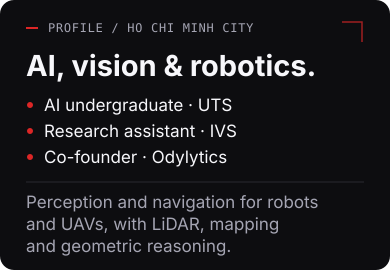 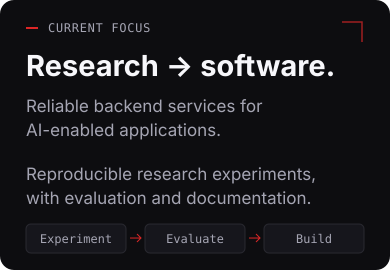

<picture><source media="(max-width: 600px)" srcset="./assets/section-work-mobile.svg" />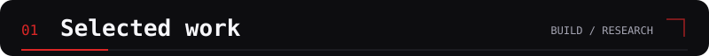</picture>

<a href="https://github.com/tuannghia2457/AquaGuard-WebApp">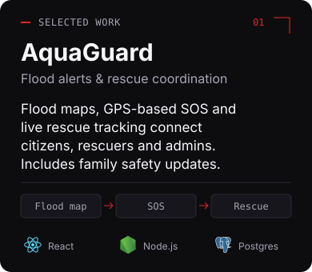</a> <a href="https://github.com/tuannghia2457/Hackathon-ANT">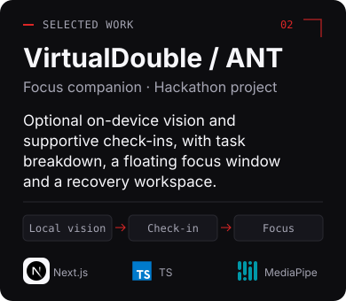</a>

[**AquaGuard · Live ↗**](https://aquaguard.vn/) · [Business model ↗](https://github.com/tuannghia2457/BMC_AquaGuard) · [**VirtualDouble · Demo ↗**](https://adc-hackathon-ant.vercel.app/)

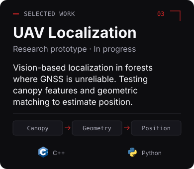 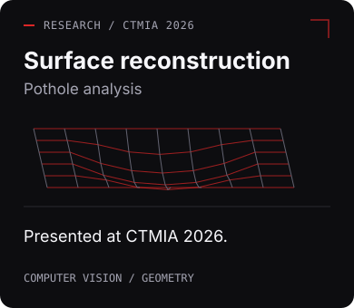

<picture><source media="(max-width: 600px)" srcset="./assets/section-stack-mobile.svg" />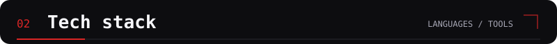</picture>

 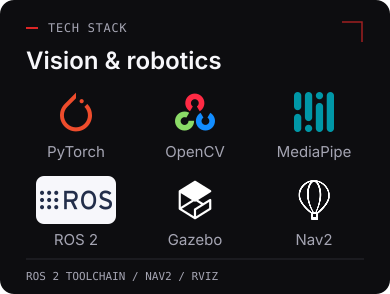

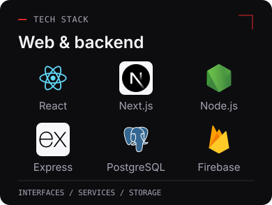 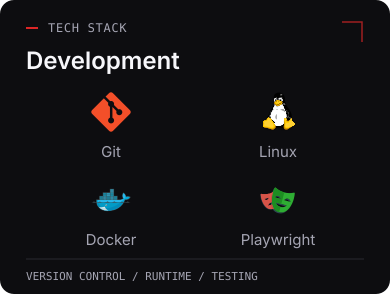

<picture><source media="(max-width: 600px)" srcset="./assets/section-recognition-mobile.svg" />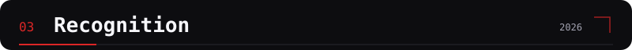</picture>

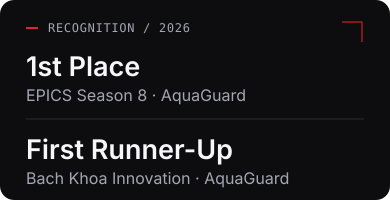 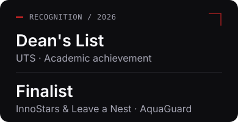

<picture><source media="(max-width: 600px)" srcset="./assets/gh-stats-mobile.svg" />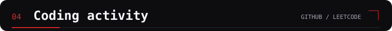</picture>

<!-- Generated from public account data; service and GitHub image caches affect refresh timing. -->
 

<picture><source media="(max-width: 600px)" srcset="./assets/footer-mobile.svg" /></picture>

